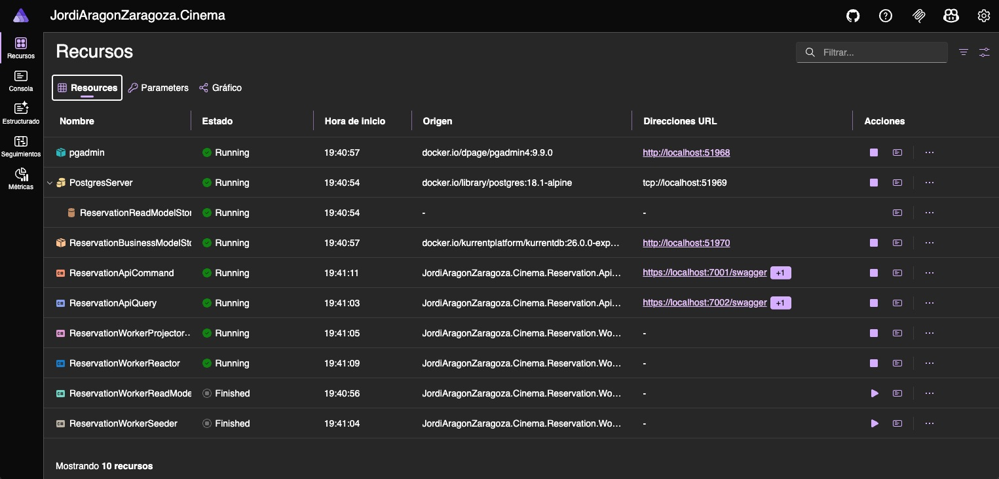
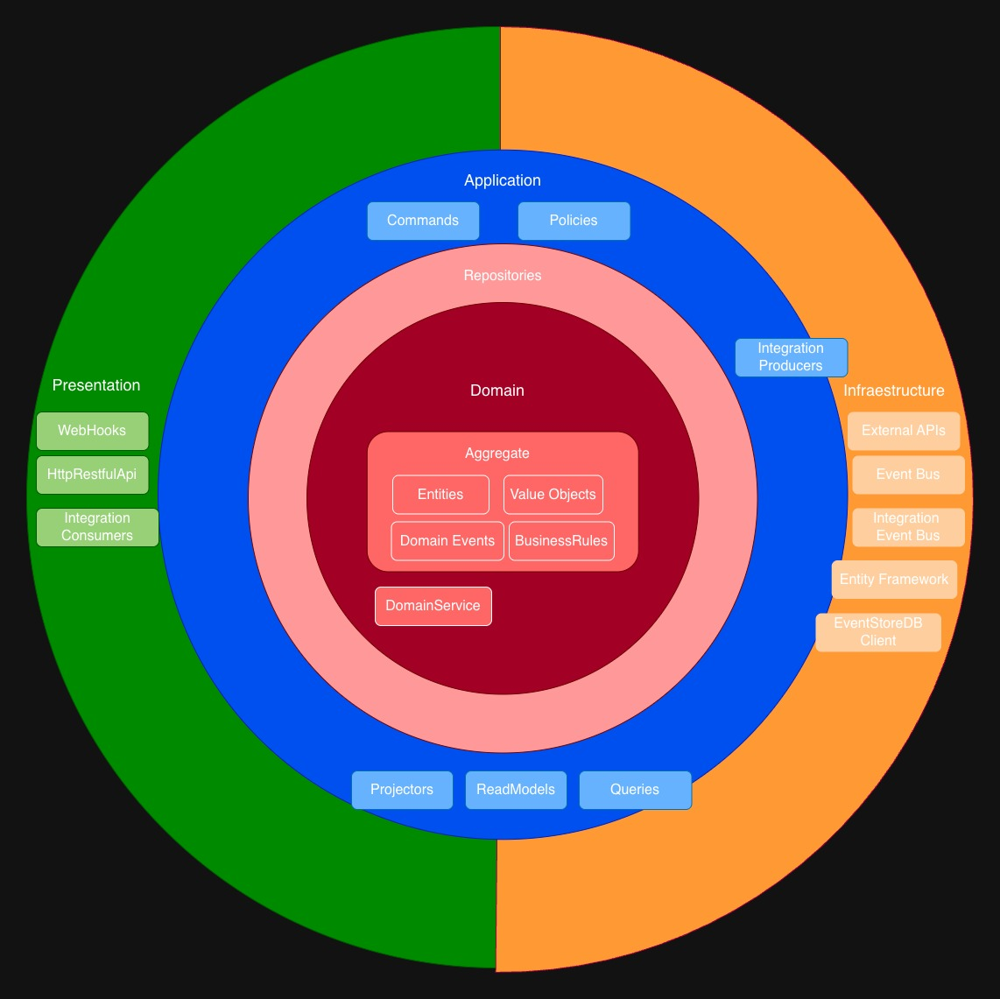
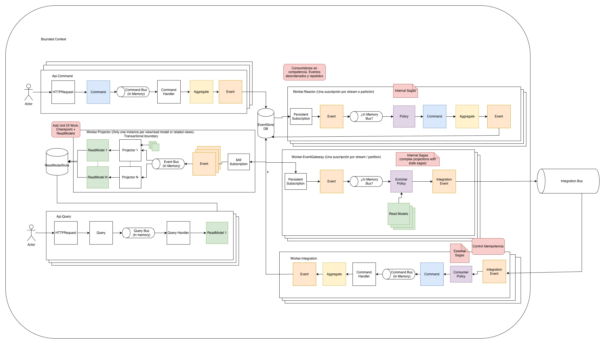
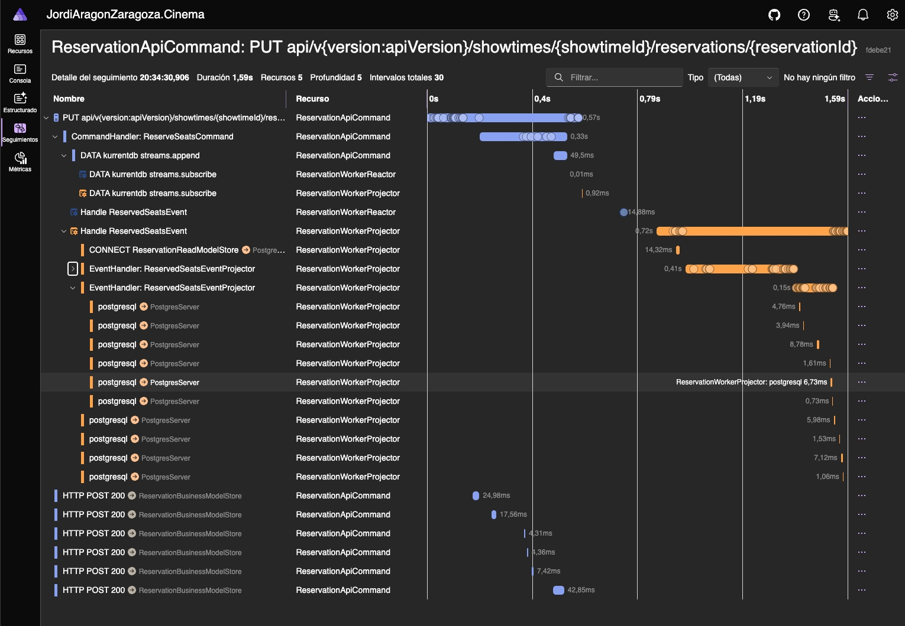

# 🎬 JordiAragonZaragoza.Cinema

**A cinema reservation system that shows Domain-Driven Design, Clean Architecture and Event Sourcing working together in real, runnable .NET code. Clone it, press `F5`, explore.**


## 👀 What you'll find inside

- 🧱 **Event-sourced aggregates** on KurrentDB, with **CQRS** over separate read and write stores
- 🔐 **Authentication** with Keycloak locally and Entra ID in the cloud, behind one provider-agnostic JWT setup
- 🛡️ **Custom multi-tenant authorization**: hierarchical scopes, roles, permissions and ownership policies, all in the application layer
- 🧭 **An `ExecutionContext`** that carries who, where and why across HTTP, messaging and the event store
- 🤖 **An MCP Gateway** so AI clients such as VS Code can use the APIs with your own identity
- 🚀 **.NET Aspire** orchestrating the whole stack
- 🧪 **Tests at every layer**, from architecture rules to system tests against a real Keycloak

If it helps you learn or inspires your own work, a ⭐ goes a long way. Thank you!

## 🏃 Getting Started

**Prerequisites**

- The .NET 10 SDK (or later) and an IDE: Visual Studio, Rider or VS Code
- Docker Desktop running
- The .NET Aspire workload (Visual Studio or the .NET CLI)
- The ASP.NET Core development certificate trusted: `dotnet dev-certs https --trust`

**Run it**

1. Open `JordiAragonZaragoza.Cinema.sln`.
2. Set the AppHost (`JordiAragonZaragoza.Cinema`) as the startup project.
3. Press `F5`, or run `dotnet run --project <path to the AppHost project>`.

The first run pulls the container images, so it takes a little longer. Aspire starts Keycloak (realm already imported), KurrentDB, PostgreSQL and Redis, plus the Command API, Query API, MCP Gateway and background workers. A seeder loads sample data on the first run, and the Aspire dashboard lists every service and its URL.



## 🎟️ Reservation Bounded Context

Manages cinema showtimes and seat reservations.

- **Reserve seats**
  - The response contains the reservation GUID, the number of seats, the auditorium and the movie.
  - The same seat cannot be reserved twice, and a sold seat cannot be reserved.
  - All seats in a reservation must be contiguous.
  - A reservation expires after 1 minute unless it is purchased.
  - No reservations are allowed after the showtime has ended.
- **Purchase a reservation**
  - Requires the reservation GUID and is only possible while the seats are reserved.
  - A reservation cannot be purchased twice.
- **Schedule or cancel a showtime** (basic functionality only, work in progress)

**Coming next:** Payments, Pricing, Invoicing, Movie catalog, Customer notifications, Marketing and Administration.

## ⚡ Try it once it's running

**Sign in with the development user** (it exists only in the local dev realm):

| Username | Password |
|---|---|
| `jordiaragonzaragoza` | `jordiaragonzaragoza` |

Every request needs a bearer token plus the context headers. This user is an admin at **cinema level**, so send all three: `x-tenant-id`, `x-partition-id` and `x-domain-id` (ids in the [seed data](#-seed-data) below). `x-correlation-id` is optional. Pick whichever way you prefer:

1. **Swagger UI:** open `/swagger` on the Command or Query API, click **Authorize**, choose `oauth2` and log in.
2. **`.http` files:** each API has one next to its controllers (for example `ReservationApiCommand.http`). Install [httpYac](https://marketplace.visualstudio.com/items?itemName=anweber.vscode-httpyac), open the file and send a request. Tokens are obtained and renewed automatically.
3. **MCP Gateway:** connect VS Code to it and sign in through the browser.

<details>
<summary>Or a quick smoke test from the terminal (Bash and <code>jq</code>)</summary>

```bash
TOKEN=$(curl -s -X POST "http://localhost:8080/realms/jordiaragonzaragoza.cinema/protocol/openid-connect/token" \
  -d grant_type=password -d client_id=cinema-system-tests \
  -d username=jordiaragonzaragoza -d password=jordiaragonzaragoza \
  -d "scope=openid profile" | jq -r .access_token)

curl -k "https://localhost:7002/api/v2/showtimes?PageNumber=1&PageSize=10" \
  -H "Authorization: Bearer $TOKEN" \
  -H "x-tenant-id: 667196fc-0e17-43f9-990d-7dc2175e6162" \
  -H "x-partition-id: 05cbd871-da4e-447b-9d62-89438df8c4a8" \
  -H "x-domain-id: 497cd8f1-620c-426f-992d-7012147f6e7c"
```

You should get the seeded *Inception* showtime back.

</details>

### 🌱 Seed data

The seeder loads a small, fixed data set (it skips this step if data already exists). Use these ids for your headers and requests.

| What | Id | Header or use |
|---|---|---|
| Tenant | `667196fc-0e17-43f9-990d-7dc2175e6162` | `x-tenant-id` |
| Partition | `05cbd871-da4e-447b-9d62-89438df8c4a8` | `x-partition-id` |
| Cinema (domain) | `497cd8f1-620c-426f-992d-7012147f6e7c` | `x-domain-id` |
| Admin user | `6bb46b99-e3d1-459b-9e1e-f8d8d7619864` | Same id as the Keycloak dev user, with the `Admin` role in the scope above |
| Movie | `3fa85f64-5717-4562-b3fc-2c963f66afa6` | *Inception* (2h 28min) |
| Auditorium | `c91aa0e0-9bc0-4db3-805c-23e3d8eabf53` | *Auditorium One*, 10 rows x 10 seats |
| Showtime | `89b073a7-cfcf-4f2a-b01b-4c7f71a0563b` | *Inception* in *Auditorium One*, one year ahead |
| Reservation | `d290f1ee-6c54-4b01-90e6-d701748f0851` | First 3 seats of the showtime, not purchased |
| Reservation owner | `a9c483ba-4f95-400b-835d-1a9c6c39e17b` | The user the seeded reservation belongs to |

💡 **Try this:** with the seeded ids, send `DELETE /api/v2/showtimes/{showtimeId}/reservations/{reservationId}` to the Command API. The reservation belongs to another user, yet it goes through: the `SelfOrAdmin` policy passes because you hold the `Admin` role.

<details>
<summary>Troubleshooting</summary>

- **`401` on every request:** the token needs `aud = jordiaragonzaragoza.cinema.api` and an `iss` that matches the configured authority exactly (`http://localhost:8080/...`). Keycloak is served over HTTP locally on purpose.
- **`400 invalid_tenant`:** add the `x-tenant-id` header.
- **`403 forbidden`:** your user has no access to the requested scope. With the development user, send all three context headers.
- **Certificate errors on the HTTPS endpoints:** trust the development certificate (see Getting Started).
- **Realm changes are ignored:** Keycloak imports the realm only when it does not exist yet. Delete its data volume to re-import it.

</details>

## 🏗️ Architecture

- Clean Architecture (Onion), SOLID and clean code, with a zero-warnings policy
- Vertical Slice Architecture (Screaming Architecture)
- Domain-Driven Design with a rich model, event-sourced aggregates and strongly typed ids
- Domain events as the source of truth
- CQRS with physical database separation
- Repository and Specification patterns
- Custom API error handling with Problem Details

Built on the [JordiAragonZaragoza.SharedKernel](https://github.com/jordiaragonzaragoza/JordiAragonZaragoza.SharedKernel) building blocks.







## 🔐 Authentication

All API requests need a **JWT** from an OpenID Connect provider.

- **Local, tests and CI:** [Keycloak](https://www.keycloak.org/), started by Aspire with the realm `jordiaragonzaragoza.cinema` imported. Nothing to configure.
- **Cloud:** Microsoft Entra ID. The configuration is prepared with placeholders in `appsettings.json`, but it has not been validated end to end yet.

The code never knows which provider is behind the token: switching is a configuration change.

<details>
<summary>Keycloak clients in the dev realm</summary>

| Client | Flow | Used by |
|---|---|---|
| `swagger-ui` | Authorization Code + PKCE | Swagger UI of each API |
| `vscode-mcp` | Authorization Code + PKCE | VS Code, to connect to the MCP Gateway |
| `cinema-system-tests` | Password grant (dev only) | System tests and `.http` files |

</details>

📖 Full design: [Authentication](./docs/Authentication.md)

## 🛡️ Authorization at a glance

Authorization lives in the application layer of each bounded context (today, Reservation). It is **custom on purpose**: it does not use `Microsoft.AspNetCore.Authorization`, because ASP.NET policies cannot express multi-tenant scope hierarchies natively. A request has to pass four doors:

```text
ValidateScopeAsync   Can this user enter this tenant / partition / cinema?   (middleware)
AuthorizeAsync       Do they hold the required roles and permissions?        (pipeline)
Policies             Does it pass rules such as "owner or admin"?            (pipeline)
Domain rules         Is the operation itself valid?                          (aggregate)
```

Requirements are declared right on the command:

```csharp
[Authorize(Permissions = "cancel:showtime", Policies = Policies.SelfOrAdmin)]
public sealed record CancelReservationCommand(
    Guid ShowtimeId,
    Guid ReservationId) : ICommand, IPolicyResourceRequest
{
    public Guid ResourceId => this.ReservationId; // the only detail the policy sees
}
```

What makes it interesting:

- **Hierarchical scopes:** access is granted per tenant, partition or cinema, and the most specific assignment wins. A tenant admin covers every cinema in the tenant.
- **Fail closed:** a policy that lacks data returns `Forbidden`, and a policy declared but not registered stops the app at startup.
- **Reads from a projection:** permissions come from a read model (PostgreSQL + Redis) built from the `User` aggregate's events, not from the aggregate itself.
- **Trusted internals:** system workers are trusted and fully audited, while anonymous external actors can never pass an `[Authorize]` command.

📖 Full design: [Authorization](./docs/AuthorizationService_es.md)

## 🧭 ExecutionContext

Every request and every message carries an `ExecutionContext`: the **actor** (who wanted it), the **executor** (which service ran it), the correlation and causation ids, and the tenant, partition and domain scope. It travels in HTTP headers, MassTransit messages and KurrentDB event metadata, so a worker reacting to an event still knows which user started the flow.

📖 Full design: [ExecutionContext](./docs/ExecutionContext_es.md)

## 🧪 Testing

- **Architecture tests** enforce the DDD rules that Vertical Slice Architecture requires
- **Unit tests:** Domain and Application
- **Functional tests** with Testcontainers: `Presentation.HttpRestfulApi` (fake authentication)
- **Integration tests** with Testcontainers: `Infrastructure.EntityFramework`
- **System tests** with .NET Aspire Testing, against a real Keycloak
- **CI:** GitHub workflow with SonarCloud integration

[](https://sonarcloud.io/summary/new_code?id=jordiaragonzaragoza_JordiAragon.Cinema)

## ⚒️ Technologies

<details>
<summary>Show the full list</summary>

- ASP.NET, Entity Framework Core and .NET Aspire
- KurrentDB (event store), PostgreSQL (projection store) and Redis (cache)
- MassTransit with RabbitMQ for messaging
- OpenTelemetry for tracing
- MediatR as in-memory event bus (to be removed)
- Ardalis.Result, Ardalis.Specification, Ardalis.SmartEnums and Ardalis.GuardClauses
- FluentValidation, Serilog and Quartz
- Swagger UI with JWT and OAuth2 (PKCE) support
- Keycloak and Microsoft Entra ID
- StyleCop and SonarAnalyzer
- xUnit, NetArchTest, Testcontainers and Ardalis.HttpClientTestExtensions

</details>

## 🧩 Cross-cutting concerns

<details>
<summary>Show the full list</summary>

- Result pattern with Ardalis.Result instead of exceptions
- API versioning and the REPR pattern
- Generic cache repository with invalidation
- MediatR pipeline behaviours (Decorator pattern):
  - `LoggerBehaviour` tracks all requests.
  - `ValidationBehaviour` adds custom validation to each query or command.
  - `AuthorizationBehavior` enforces roles, permissions and policies.
  - `UnitOfWorkBehaviour` is the main exception handler and commits or rolls back the transaction.
  - `CachingBehavior` and `InvalidateCachingBehavior` add or remove requests from the cache.
  - `DomainEventsDispatcherBehaviour` raises and dispatches events before the transaction completes (deferred approach).
  - `PerformanceBehaviour` tracks execution time.

</details>

## 🙏 Resources and Inspiration

Special thanks to all these authors for sharing their knowledge and expertise:

- <a href="https://github.com/ardalis/CleanArchitecture" target="_blank">Ardalis: Clean Architecture</a>
- <a href="https://github.com/jasontaylordev/CleanArchitecture" target="_blank">Jason Taylor: Clean Architecture</a>
- <a href="https://www.oreilly.com/library/view/implementing-domain-driven-design/9780133039900/" target="_blank">Vaughn Vernon: Implementing Domain-Driven Design (book)</a>
- <a href="https://kalele.io/books/ddd-destilado/" target="_blank">Vaughn Vernon: Domain-Driven Design Destilado (book)</a>
- <a href="https://www.amazon.com/Hands-Domain-Driven-Design-NET-ebook/dp/B07C5WSR9B" target="_blank">Alexey Zimarev: Hands-on Domain-Driven Design (book)</a>
- <a href="https://github.com/oskardudycz/EventSourcing.NetCore" target="_blank">Oskar Dudycz: EventSourcing .NET</a>
- <a href="https://eventuous.dev/" target="_blank">Alexey Zimarev: Eventuous</a>
- <a href="https://github.com/kgrzybek/sample-dotnet-core-cqrs-api" target="_blank">Kamil Grzybek: Sample .NET Core REST API CQRS</a>
- <a href="https://github.com/kgrzybek/modular-monolith-with-ddd" target="_blank">Kamil Grzybek: Modular Monolith With DDD</a>
- <a href="https://www.youtube.com/watch?v=Lw04HRF8ies" target="_blank">NDC Oslo: Udi Dahan - Talk Session: CQRS pitfalls and patterns</a>
- <a href="https://www.youtube.com/watch?v=26xrX113KZc" target="_blank">Explore DDD: Mauro Servienti - Talk Session: Welcome to the (State) Machine</a>
- <a href="https://www.youtube.com/watch?v=KkzvQSuYd5I" target="_blank">Explore DDD: Mauro Servienti - Talk Session: All Our Aggregates Are Wrong</a>
- <a href="https://www.youtube.com/watch?v=tVnIUZbsxWI" target="_blank">NDC Oslo: Adam Ralph - Talk Session: Finding your service boundaries - a practical guide</a>
- <a href="https://www.youtube.com/watch?v=fGm62ra_mQ8" target="_blank">Øredev: Alberto Brandolini - Talk Session: 100,000 Orange Stickies Later</a>
- <a href="https://www.confluent.io/events/kafka-summit-london-2024/event-modeling-anti-patterns/" target="_blank">KS2024: Oskar Dudycz - Talk Session: Event Modeling Anti-patterns</a>
- <a href="https://www.youtube.com/watch?v=kPV1SkdSnhE" target="_blank">Vladimir Khorikov: DDD in a nutshell</a>
- <a href="https://odysee.com/@sunnyAtticSoftware:a?view=content" target="_blank">Diego Martin: SunnyAttic Software Videos</a>
- <a href="https://www.youtube.com/watch?v=SUiWfhAhgQw" target="_blank">Jimmy Bogard: Vertical Slice Architecture</a>
- <a href="https://www.youtube.com/@CodeOpinion" target="_blank">CodeOpinion: Youtube Channel</a>
- <a href="https://www.youtube.com/@amantinband" target="_blank">Amichai Mantinband: Youtube Channel</a>
- <a href="https://www.youtube.com/@MilanJovanovicTech" target="_blank">Milan Jovanović: Youtube Channel</a>

## 🔀 Versions

The main branch targets .NET 10. Previous versions are available here:
* [.NET 9](https://github.com/jordiaragonzaragoza/JordiAragonZaragoza.Cinema/tree/net9.0)
* [.NET 8](https://github.com/jordiaragonzaragoza/JordiAragonZaragoza.Cinema/tree/net8.0)
* [.NET 7](https://github.com/jordiaragonzaragoza/JordiAragonZaragoza.Cinema/tree/net7.0)

## 🧐 About

The Cinema Project was developed by <a href="https://www.linkedin.com/in/jordiaragonzaragoza/" target="_blank">Jordi Aragón Zaragoza</a>

## 👮 License

[Creative Commons Attribution-NonCommercial-NoDerivatives 4.0 International License](http://creativecommons.org/licenses/by-nc-nd/4.0/).

[](http://creativecommons.org/licenses/by-nc-nd/4.0/)
